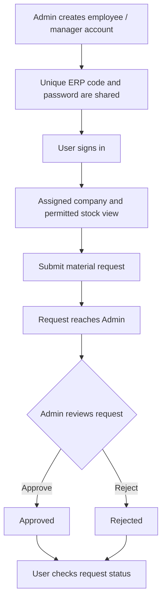

<div align="center">



# 🏗️ BuildCore ERP

### Strong foundations. Smarter business.

**A unified workspace for construction and building-material operations.**

<p>
  <a href="https://erp-build-two.vercel.app/">
    
  </a>
  <a href="https://buildcore-erp-1.onrender.com/">
    
  </a>
  <a href="https://github.com/Ashish-kumar-upadhyay/Buildcore-ERP">
    
  </a>
</p>


<br/>


</div>

---

## ⚡ The idea

Construction operations involve materials, stock, purchasing, teams, and orders. When these activities are scattered across different tools, it becomes harder to track what is happening and who is responsible.

**BuildCore ERP brings these workflows into one organized workspace** with role-based access and a clear material-request approval process.

> **One workspace. Clear responsibilities. Better control.**

## 🎯 Explore the workspace

<table>
<tr>
<td width="50%" valign="top">

### 📦 Inventory
Keep building-material stock information organized and accessible.

</td>
<td width="50%" valign="top">

### 🛒 Purchasing
Support purchase and vendor-related business workflows.

</td>
</tr>
<tr>
<td width="50%" valign="top">

### 📊 Sales
Keep sales and order activity connected to daily operations.

</td>
<td width="50%" valign="top">

### 👥 People & HR
Manage employee records and role-based workspaces.

</td>
</tr>
<tr>
<td width="50%" valign="top">

### 🧱 Material Requests
Employees can request materials for their assigned company, with quantity and required date.

</td>
<td width="50%" valign="top">

### 🛡️ Admin Approval
Admins can review incoming requests and approve or reject them.

</td>
</tr>
</table>

## 🔐 Designed around roles

BuildCore ERP keeps employee access limited to the work they need to perform.

| Admin workspace | Employee / Manager workspace |
|---|---|
| Add and manage employees | Sign in using a unique ERP code and password |
| Assign users to a company | View their assigned company |
| Review material requests | View relevant product and stock information |
| Approve or reject requests | Submit material requests |
| Manage administrative workflows | Track the status of their own requests |

### 🔄 Material request journey



## 🧩 Feature progress

| Feature | Status |
|---|:---:|
| Admin employee creation | ✅ |
| Unique ERP login code and password | ✅ |
| Role-based employee access restrictions | ✅ |
| Assigned-company visibility | ✅ |
| Employee material-request submission | ✅ |
| Employee request-status tracking | ✅ |
| Admin request review and approval / rejection | ✅ |
| Attendance check-in / check-out | 🚧 Planned |
| Leave request and approval | 🚧 Planned |
| GPS-based attendance verification | 🚧 Planned |
| Expanded reports and operational insights | 🚧 Planned |

## 🌐 Deployments

<div align="center">

| Environment | URL |
|---|---|
| **Frontend / Live Application** | [Launch BuildCore ERP ↗](https://erp-build-two.vercel.app/) |
| **Backend / API Service** | [Open Render Service ↗](https://buildcore-erp-1.onrender.com/) |
| **Source Repository** | [View on GitHub ↗](https://github.com/Ashish-kumar-upadhyay/Buildcore-ERP) |

</div>

> **Heads-up:** The backend currently uses Render's free instance. It may spin down after inactivity, so the first request after a quiet period can take around 50 seconds or more.

## 🧑‍💻 Run locally

### 1. Clone the repository

```bash
git clone https://github.com/Ashish-kumar-upadhyay/Buildcore-ERP.git
cd Buildcore-ERP
```

### 2. Install dependencies

Run the following in the relevant frontend and backend project directories:

```bash
npm install
```

### 3. Configure environment variables

Create the required local environment file(s) using the variable names expected by the project. Add database connection details and other required configuration locally.

**Never commit passwords, API keys, database credentials, or production secrets.**

### 4. Start the development server

Use the script defined in the relevant `package.json`:

```bash
npm run dev
```

> If frontend and backend are separate applications, start each from its own directory. Refer to their `package.json` files for the exact scripts and required environment variables.

## 🧰 Built with

The project uses a web application frontend and a separately deployed backend service. For the exact framework, libraries, and versions, refer to the repository's package manifests.

## 👨‍🚀 Project creator

<div align="center">

### Ashish Kumar Upadhyay

**Full Stack Developer**

<a href="https://github.com/Ashish-kumar-upadhyay">
  
</a>

<br/><br/>

*Building practical software for real-world business workflows.*

</div>

---

<div align="center">


**STRONG FOUNDATIONS. SMARTER BUSINESS.**

</div>
