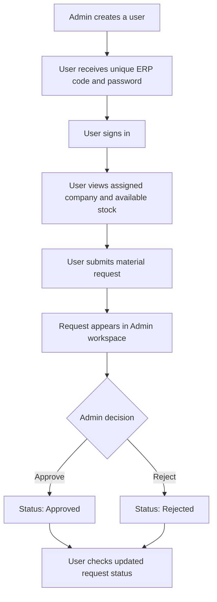

<div align="center">

<!-- BuildCore ERP: keep the project name as real Markdown text so it remains visible
     even if an external banner, SVG, or badge fails to load. -->

<h1>🏗️ BuildCore ERP</h1>

### Strong foundations. Smarter business.

<p>
  <strong>A connected workspace for construction-material businesses.</strong><br/>
  Manage inventory, purchasing, sales, people, and material requests in one place.
</p>

<p>
  <a href="https://erp-build-two.vercel.app/"><strong>🚀 Open Live Application</strong></a>
  &nbsp; • &nbsp;
  <a href="https://buildcore-erp-1.onrender.com/"><strong>⚙️ Backend Service</strong></a>
  &nbsp; • &nbsp;
  <a href="https://github.com/Ashish-kumar-upadhyay/Buildcore-ERP"><strong>💻 Source Code</strong></a>
</p>


<br/>


</div>

---

## ✨ About BuildCore ERP

**BuildCore ERP** is a web-based business management workspace designed for construction and building-material operations. It brings day-to-day workflows together so teams can keep materials, people, requests, and business activity organized.

The goal is simple: reduce scattered work, make responsibilities clear, and give each role access only to the tools it needs.

## 🔗 Project Links

| Resource | Link |
|---|---|
| **Primary live application** | [erp-build-two.vercel.app](https://erp-build-two.vercel.app/) |
| **Backend service** | [buildcore-erp-1.onrender.com](https://buildcore-erp-1.onrender.com/) |
| **GitHub repository** | [Ashish-kumar-upadhyay/Buildcore-ERP](https://github.com/Ashish-kumar-upadhyay/Buildcore-ERP) |

> **Deployment note:** The backend is hosted on Render's free instance. After inactivity, its first request may take around 50 seconds or longer while the service wakes up.

## 🚀 Key Modules

<table>
  <tr>
    <td width="50%">
      <h3>📦 Inventory</h3>
      Organize building materials and keep stock information accessible.
    </td>
    <td width="50%">
      <h3>🛒 Purchasing</h3>
      Support purchase and vendor-related workflows.
    </td>
  </tr>
  <tr>
    <td width="50%">
      <h3>📈 Sales</h3>
      Keep sales and order activity within the same workspace.
    </td>
    <td width="50%">
      <h3>👥 People & HR</h3>
      Manage employee records and role-based workspaces.
    </td>
  </tr>
  <tr>
    <td width="50%">
      <h3>🧱 Material Requests</h3>
      Employees can submit material requirements for an assigned company and track the request status.
    </td>
    <td width="50%">
      <h3>✅ Admin Approval</h3>
      Admins can review submitted material requests and approve or reject them.
    </td>
  </tr>
</table>

## 🔐 Role-Based Access

BuildCore ERP separates access by role to keep each workspace focused.

| Role | Access |
|---|---|
| **Admin** | Manages the workspace, employee access, and material-request approvals. |
| **Manager / Employee** | Uses the assigned workspace, views relevant product/stock information, submits material requests, and checks request status. |

### Material Request Workflow



## 🧭 Current Feature Status

The checklist below distinguishes implemented workflows from items still planned. Update it as development progresses.

- [x] Admin can add employees.
- [x] Unique ERP login code and password flow.
- [x] Role-based employee workspace restrictions.
- [x] Assigned-company visibility for employees.
- [x] Employee material-request submission.
- [x] Employee can view their own request status.
- [x] Admin can review and approve/reject material requests.
- [ ] Attendance check-in / check-out.
- [ ] Leave request and approval workflow.
- [ ] GPS-based attendance verification.
- [ ] Expanded reports and operational insights.

## 🖥️ Interface

BuildCore ERP uses a clean construction-business visual direction with warm amber accents, neutral surfaces, and focused workspace sections.

## 🛠️ Run Locally

1. Clone the repository:

   ```bash
   git clone https://github.com/Ashish-kumar-upadhyay/Buildcore-ERP.git
   cd Buildcore-ERP
   ```

2. Install dependencies in the relevant application folders:

   ```bash
   npm install
   ```

3. Configure the environment variables required by the project. Keep secrets in local environment files and never commit credentials.

4. Start the application using the scripts defined in the relevant `package.json`:

   ```bash
   npm run dev
   ```

> If the repository contains separate frontend and backend folders, install dependencies and run the development script in each folder. Check each folder's `package.json` for the exact available scripts and required environment variables.

## 👨‍💻 Developer

<div align="center">

### Ashish Kumar Upadhyay

**Full Stack Developer**

[](https://github.com/Ashish-kumar-upadhyay)

<br/>

*Built to connect construction business operations.*

</div>

---

<div align="center">


**BUILDCORE ERP** · Strong foundations. Smarter business.

</div>
